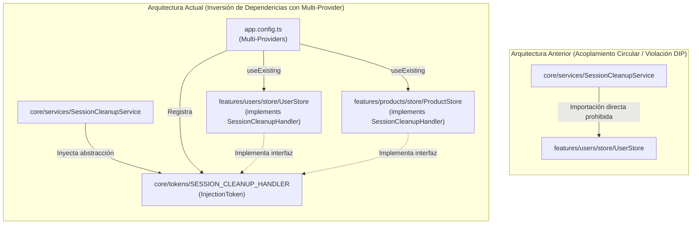
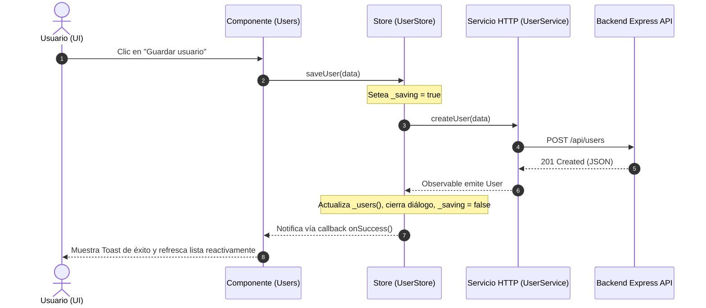

# Informe Técnico y Educativo — Fase 3: Desacoplamiento Arquitectónico y Rendimiento

**Fecha de Ejecución:** 2026-11-23  
**Estado:** COMPLETADA  
**Rama:** `refactor/angular-quality`  
**Skills Aplicadas:** `angular-architecture`, `angular-developer`, `typescript-expert`, `code-review`  

---

## 1. Resumen Ejecutivo

### Estado de la Fase
La **Fase 3: Desacoplamiento Arquitectónico y Rendimiento** ha sido completada con éxito. Esta fase abordó problemas estructurales profundos de diseño de software en la capa `core` y optimizó el ciclo de detección de cambios de Angular 21, transitando de una arquitectura acoplada a una solución orientada a **Clean Architecture**, **Inversión de Dependencias (SOLID)** y **Reactividad Basada en Signals con OnPush**.

### Problemas Arquitectónicos Identificados
1. **Acoplamiento Directo en `Core` (Violación de DIP):** El servicio central de cierre de sesión [src/app/core/services/session-cleanup.ts](file:///d:/trabajo/clases%20angular/proyecto-angular/src/app/core/services/session-cleanup.ts) importaba e inyectaba de forma estática `UserStore` desde `features/users`. Esto obligaba al núcleo (`core`) a depender de una funcionalidad específica (`features`), imposibilitando que otros stores (como `ProductStore`) participaran en la limpieza de sesión sin modificar `core`.
2. **Antipatrones de Sincronización en `effect()`:** Los componentes de formulario [UserForm](file:///d:/trabajo/clases%20angular/proyecto-angular/src/app/features/users/user-form/user-form.ts) y [ProductForm](file:///d:/trabajo/clases%20angular/proyecto-angular/src/app/features/products/product-form/product-form.ts) implementaban variables mutables dentro del closure del constructor (`previousVisible`, `previousUserId`, `previousProductId`) para rastrear transiciones de visibilidad de los modales, generando efectos secundarios frágiles y riesgos de condiciones de carrera.
3. **Estrategia de Detección de Cambios por Defecto (`Default`):** Varios componentes principales (`AdminLayout`, `Header`, `Sidebar`, `Login`, `Dashboard`, `UserForm`, `ProductForm`) utilizaban la estrategia predeterminada de detección de cambios, forzando comprobaciones de suciedad en todo el subárbol DOM ante cualquier evento asíncrono global.
4. **Ausencia de Contrato Formal de Limpieza:** No existía una abstracción o contrato tipado que definiera qué componentes o servicios debían purgar su estado en memoria cuando el usuario cerraba la sesión.

### Soluciones Implementadas
1. **Contrato `SessionCleanupHandler` y Token `SESSION_CLEANUP_HANDLER`:** Se creó el token [src/app/core/tokens/session-cleanup.token.ts](file:///d:/trabajo/clases%20angular/proyecto-angular/src/app/core/tokens/session-cleanup.token.ts) utilizando el patrón **Multi-Provider** de Angular (`multi: true`).
2. **Desacoplamiento Absoluto de `SessionCleanupService`:** El servicio central ahora inyecta exclusivamente `SESSION_CLEANUP_HANDLER` con modificador `{ optional: true }`. No conoce ningún store concreto.
3. **Implementación de Limpieza en Features:** `UserStore` y `ProductStore` implementan la interfaz `SessionCleanupHandler` exponiendo el método `cleanup(): void { this.reset(); }` y registrándose en [src/app/app.config.ts](file:///d:/trabajo/clases%20angular/proyecto-angular/src/app/app.config.ts).
4. **Refactorización Limpia de `effect()` con `untracked()`:** Se simplificó la sincronización de formularios al abrir modales eliminando variables mutables de estado previo y encapsulando `loadForm()` dentro de `untracked()`.
5. **Adopción de `ChangeDetectionStrategy.OnPush`:** Se configuró `OnPush` en [AdminLayout](file:///d:/trabajo/clases%20angular/proyecto-angular/src/app/layout/admin-layout/admin-layout.ts), [Header](file:///d:/trabajo/clases%20angular/proyecto-angular/src/app/layout/header/header.ts), [Sidebar](file:///d:/trabajo/clases%20angular/proyecto-angular/src/app/layout/sidebar/sidebar.ts), [Login](file:///d:/trabajo/clases%20angular/proyecto-angular/src/app/features/auth/login/login.ts), [Dashboard](file:///d:/trabajo/clases%20angular/proyecto-angular/src/app/features/dashboard/dashboard.ts), [UserForm](file:///d:/trabajo/clases%20angular/proyecto-angular/src/app/features/users/user-form/user-form.ts) y [ProductForm](file:///d:/trabajo/clases%20angular/proyecto-angular/src/app/features/products/product-form/product-form.ts).
6. **Pruebas Automatizadas del Desacoplamiento:** Se creó la suite [src/app/core/services/session-cleanup.spec.ts](file:///d:/trabajo/clases%20angular/proyecto-angular/src/app/core/services/session-cleanup.spec.ts) con 2 pruebas unitarias que validan la ejecución de todos los handlers registrados y la resiliencia en ausencia de proveedores.

---

## 2. Objetivos Arquitectónicos

1. **Principio de Inversión de Dependencias (Dependency Inversion Principle - DIP):** Los módulos de alto nivel (`core`) no deben depender de módulos de bajo nivel (`features`). Ambos deben depender de abstracciones (interfaces y tokens).
2. **Principio Abierto/Cerrado (Open/Closed Principle - OCP):** El sistema debe permitir registrar nuevos almacenes de estado para limpieza de sesión sin necesidad de abrir ni modificar `SessionCleanupService`.
3. **Aislamiento de Capas:** Garantizar un flujo unidireccional de dependencias: `features` pueden depender de `core` y `shared`, pero `core` jamás debe depender de `features`.
4. **Reactividad Predecible y de Alto Rendimiento:** Aprovechar el sistema de Signals de Angular 21 y `OnPush` para que los componentes solo se re-rendericen cuando sus señales de entrada o locales cambian de valor por referencia o identidad.

---

## 3. Arquitectura Anterior vs. Arquitectura Actual

### Diagrama de Dependencias (Antes vs. Después)



### Separación de Responsabilidades por Capas

| Capa | Responsabilidad | Dependencias Permitidas | Ejemplo en el Proyecto |
| :--- | :--- | :--- | :--- |
| **`core/`** | Servicios singleton globales, interceptores HTTP, guards de ruta y tokens de infraestructura. | `@angular/*`, librerías de terceros (RxJS). **Nunca features**. | [SessionCleanupService](file:///d:/trabajo/clases%20angular/proyecto-angular/src/app/core/services/session-cleanup.ts), [AuthService](file:///d:/trabajo/clases%20angular/proyecto-angular/src/app/core/services/auth.ts), [SESSION_CLEANUP_HANDLER](file:///d:/trabajo/clases%20angular/proyecto-angular/src/app/core/tokens/session-cleanup.token.ts). |
| **`shared/`** | Componentes reutilizables, directivas y pipes sin estado de negocio acoplado. | `@angular/*`, utilidades comunes. | [AccessibleChart](file:///d:/trabajo/clases%20angular/proyecto-angular/src/app/shared/directives/accessible-chart.ts), [FocusTrapDirective](file:///d:/trabajo/clases%20angular/proyecto-angular/src/app/directive/focus-trap.directive.ts). |
| **`layout/`** | Estructura visual envolvente: encabezado, barra lateral y contenedores de navegación. | `core/`, `shared/`, servicios de sesión y permisos. | [AdminLayout](file:///d:/trabajo/clases%20angular/proyecto-angular/src/app/layout/admin-layout/admin-layout.ts), [Header](file:///d:/trabajo/clases%20angular/proyecto-angular/src/app/layout/header/header.ts), [Sidebar](file:///d:/trabajo/clases%20angular/proyecto-angular/src/app/layout/sidebar/sidebar.ts). |
| **`features/`** | Módulos funcionales de negocio (usuarios, productos, configuración, dashboard). | `core/`, `shared/`. No deben acoplarse estrechamente entre sí. | [Users](file:///d:/trabajo/clases%20angular/proyecto-angular/src/app/features/users/users.ts), [Products](file:///d:/trabajo/clases%20angular/proyecto-angular/src/app/features/products/products.ts), [Dashboard](file:///d:/trabajo/clases%20angular/proyecto-angular/src/app/features/dashboard/dashboard.ts). |

---

## 4. Refactorización de `SessionCleanupService` y Multi-Providers

### A. Creación del Token e Interfaz Contractual

**Ruta:** [src/app/core/tokens/session-cleanup.token.ts](file:///d:/trabajo/clases%20angular/proyecto-angular/src/app/core/tokens/session-cleanup.token.ts)

```typescript
import { InjectionToken } from '@angular/core';

export interface SessionCleanupHandler {
  cleanup(): void;
}

export const SESSION_CLEANUP_HANDLER = new InjectionToken<SessionCleanupHandler[]>(
  'SESSION_CLEANUP_HANDLER',
);
```

#### Explicación Técnica:
- `SessionCleanupHandler`: Interfaz pura de TypeScript que estipula la firma de cualquier servicio capaz de restablecer su estado al cerrar sesión.
- `InjectionToken<SessionCleanupHandler[]>`: Ficha de inyección tipada en tiempo de ejecución. Al configurarse con `multi: true`, el inyector de Angular acumula todas las instancias registradas en un arreglo homogéneo.

---

### B. Implementación Anterior vs. Implementación Refactorizada

#### Código Anterior ([src/app/core/services/session-cleanup.ts](file:///d:/trabajo/clases%20angular/proyecto-angular/src/app/core/services/session-cleanup.ts)):
```typescript
// CÓDIGO ANTERIOR: Dependencia dura directa hacia una feature
import { Injectable, inject } from '@angular/core';
import { UserStore } from '../../features/users/store/user-store';

@Injectable({
  providedIn: 'root',
})
export class SessionCleanupService {
  private readonly userStore = inject(UserStore);

  clear(): void {
    this.userStore.reset();
  }
}
```

#### Código Refactorizado:
```typescript
// CÓDIGO REFACTORIZADO: Desacoplado mediante Token e Inyección Opcional
import { Injectable, inject } from '@angular/core';
import { SESSION_CLEANUP_HANDLER, SessionCleanupHandler } from '../tokens/session-cleanup.token';

@Injectable({
  providedIn: 'root',
})
export class SessionCleanupService {
  private readonly handlers = inject(SESSION_CLEANUP_HANDLER, { optional: true }) ?? [];

  clear(): void {
    const handlerList: SessionCleanupHandler[] = Array.isArray(this.handlers)
      ? this.handlers
      : [this.handlers];

    for (const handler of handlerList) {
      if (handler && typeof handler.cleanup === 'function') {
        handler.cleanup();
      }
    }
  }
}
```

#### Explicación Línea por Línea:
- `inject(SESSION_CLEANUP_HANDLER, { optional: true }) ?? []`: Inyecta la lista de handlers. La bandera `{ optional: true }` evita que Angular lance un error `NullInjectorError` si ningún handler fue registrado en el inyector (por ejemplo, en pruebas unitarias aisladas). El operador `?? []` garantiza un valor predeterminado seguro.
- `Array.isArray(this.handlers) ? ... : [...]`: Salvaguarda defensiva por si en alguna configuración se proveyó un único handler sin la opción `multi: true`.
- `for (const handler of handlerList)`: Itera sobre cada store registrado y ejecuta polimórficamente su método `cleanup()`.
- `handler && typeof handler.cleanup === 'function'`: Comprobación de tipo en tiempo de ejecución para asegurar robustez ante objetos nulos o malformados.

---

### C. Registro en la Configuración Global de la Aplicación

**Ruta:** [src/app/app.config.ts](file:///d:/trabajo/clases%20angular/proyecto-angular/src/app/app.config.ts)

```typescript
export const appConfig: ApplicationConfig = {
  providers: [
    provideRouter(routes),
    provideHttpClient(
      withInterceptors([apiErrorInterceptor, credentialsInterceptor, sessionInterceptor]),
    ),
    providePrimeNG({ ... }),
    {
      provide: SESSION_CLEANUP_HANDLER,
      useExisting: UserStore,
      multi: true,
    },
    {
      provide: SESSION_CLEANUP_HANDLER,
      useExisting: ProductStore,
      multi: true,
    },
  ],
};
```

#### ¿Por qué `useExisting` y no `useClass`?
Si utilizáramos `useClass: UserStore`, Angular crearía una **segunda instancia** independiente de `UserStore` dedicada a la limpieza, dejando intacta la instancia real utilizada por los componentes. Con `useExisting: UserStore`, le indicamos al inyector que apunte a la instancia singleton ya existente en el contenedor de dependencias (`providedIn: 'root'`).

---

## 5. Implementación de `ChangeDetectionStrategy.OnPush`

### Fundamento Teórico para Diseñadores y Desarrolladores
Angular utiliza por defecto `ChangeDetectionStrategy.Default`. Bajo esta estrategia:
1. Cualquier macro o micro-tarea (un click, un `setTimeout`, una respuesta HTTP) dispara un recorrido completo de arriba hacia abajo (*dirty checking*) en todo el árbol de componentes.
2. Cada enlace de plantilla (`{{ user.name }}`) se evalúa nuevamente, incluso si sus datos no han cambiado.

Con `ChangeDetectionStrategy.OnPush`:
1. El componente se vuelve "durmiente" para el motor de detección de cambios.
2. Angular solo revisa el componente en tres situaciones concretas:
   - Uno de sus `@Input()` (o `input()`) cambia de referencia (un valor nuevo o inmutable).
   - Un evento del propio componente es disparado desde su plantilla (como un `(click)`).
   - Una señal (`Signal`) leída en la plantilla emite un nuevo valor.

### Componentes Migrados a `OnPush` en la Fase 3
- [AdminLayout](file:///d:/trabajo/clases%20angular/proyecto-angular/src/app/layout/admin-layout/admin-layout.ts) (`changeDetection: ChangeDetectionStrategy.OnPush`)
- [Header](file:///d:/trabajo/clases%20angular/proyecto-angular/src/app/layout/header/header.ts) (`changeDetection: ChangeDetectionStrategy.OnPush`)
- [Sidebar](file:///d:/trabajo/clases%20angular/proyecto-angular/src/app/layout/sidebar/sidebar.ts) (`changeDetection: ChangeDetectionStrategy.OnPush`)
- [Login](file:///d:/trabajo/clases%20angular/proyecto-angular/src/app/features/auth/login/login.ts) (`changeDetection: ChangeDetectionStrategy.OnPush`)
- [Dashboard](file:///d:/trabajo/clases%20angular/proyecto-angular/src/app/features/dashboard/dashboard.ts) (`changeDetection: ChangeDetectionStrategy.OnPush`)
- [UserForm](file:///d:/trabajo/clases%20angular/proyecto-angular/src/app/features/users/user-form/user-form.ts) (`changeDetection: ChangeDetectionStrategy.OnPush`)
- [ProductForm](file:///d:/trabajo/clases%20angular/proyecto-angular/src/app/features/products/product-form/product-form.ts) (`changeDetection: ChangeDetectionStrategy.OnPush`)

---

## 6. Refactorización de Formularios Reactivos con Signals (`UserForm` y `ProductForm`)

### A. Antipatrón Detectado en `effect()`

En Angular, `effect()` está diseñado para **reaccionar a cambios de estado con efectos colaterales externos** (como sincronizar con `localStorage` o manipular APIs de terceros). Utilizar `effect()` para sincronizar manualmente estados internos mediante variables de cierre es un antipatrón frecuente.

#### Código Anterior ([UserForm](file:///d:/trabajo/clases%20angular/proyecto-angular/src/app/features/users/user-form/user-form.ts)):
```typescript
// CÓDIGO ANTERIOR: Variables mutables en closure y lógica imperativa compleja
export class UserForm {
  constructor() {
    let previousVisible = false;
    let previousUserId: string | null = null;

    effect(() => {
      const isVisible = this.visible();
      const currentUser = this.user();
      const currentUserId = currentUser?.id ?? null;

      const justOpened = isVisible && !previousVisible;
      const userChanged = isVisible && currentUserId !== previousUserId;

      previousVisible = isVisible;
      previousUserId = isVisible ? currentUserId : null;

      if (justOpened || userChanged) {
        untracked(() => this.loadForm(currentUser));
      }
    });
  }
}
```

#### Código Refactorizado:
```typescript
// CÓDIGO REFACTORIZADO: Declarativo, conciso y libre de variables mutables
export class UserForm {
  constructor() {
    effect(() => {
      if (this.visible()) {
        const currentUser = this.user();
        untracked(() => this.loadForm(currentUser));
      }
    });
  }
}
```

#### Beneficios Técnicos:
1. **Eliminación de Memoria Mutable en Closure:** Se eliminan `previousVisible` y `previousUserId`. El ciclo de vida de la señal de visibilidad (`this.visible()`) es suficiente para activar la carga cuando el modal se despliega.
2. **Rol Crucial de `untracked()`:** Al llamar a `this.loadForm(currentUser)` dentro de `untracked()`, nos aseguramos de que cualquier señal que `loadForm` pudiera leer internamente no sea registrada como dependencia reactiva del `effect`. Esto previene bucles de re-ejecución infinitos (*infinite reaction loops*).
3. **Mantenibilidad:** Mismo patrón aplicado de forma idéntica en [ProductForm](file:///d:/trabajo/clases%20angular/proyecto-angular/src/app/features/products/product-form/product-form.ts).

---

## 7. Gestión de Estados Mediante Stores (`UserStore` y `ProductStore`)

### Flujo Unidireccional de Datos



### Anatomía del Store Profesional con Signals

En [UserStore](file:///d:/trabajo/clases%20angular/proyecto-angular/src/app/features/users/store/user-store.ts) y [ProductStore](file:///d:/trabajo/clases%20angular/proyecto-angular/src/app/features/products/store/product-store.ts):
1. **Estado Privado (Writable):** Se definen como `signal<T>(initialValue)` privados (e.g., `private readonly _users = signal<User[]>([]);`). Ningún componente puede mutar el estado arbitrariamente desde fuera.
2. **Estado Público (Readonly):** Se exponen mediante `asReadonly()` (e.g., `readonly users = this._users.asReadonly();`). La vista solo puede consumir el estado.
3. **Derivaciones Puras (`computed`):** Totales, contadores de activos/inactivos y filtros de búsqueda se derivan mediante `computed(() => ...)` sin duplicar memoria.
4. **Gestión de Ciclo de Vida y Fugas de Memoria:** Cada suscripción HTTP en el store utiliza `takeUntilDestroyed(this.destroyRef)` asegurando que cualquier petición en vuelo sea cancelada si el inyector o servicio se destruye.

---

## 8. Archivos Modificados Durante la Fase 3

| Archivo | Naturaleza del Cambio | Justificación |
| :--- | :---: | :--- |
| [src/app/core/tokens/session-cleanup.token.ts](file:///d:/trabajo/clases%20angular/proyecto-angular/src/app/core/tokens/session-cleanup.token.ts) | **Creado** | Declaración del contrato `SessionCleanupHandler` y token `SESSION_CLEANUP_HANDLER`. |
| [src/app/core/services/session-cleanup.ts](file:///d:/trabajo/clases%20angular/proyecto-angular/src/app/core/services/session-cleanup.ts) | Modificado | Eliminación de la dependencia con `UserStore`; inyección multi-provider. |
| [src/app/core/services/session-cleanup.spec.ts](file:///d:/trabajo/clases%20angular/proyecto-angular/src/app/core/services/session-cleanup.spec.ts) | **Creado** | Suite unitaria automatizada con 2 pruebas para verificar el servicio de limpieza. |
| [src/app/app.config.ts](file:///d:/trabajo/clases%20angular/proyecto-angular/src/app/app.config.ts) | Modificado | Provisión de `UserStore` y `ProductStore` como handlers de `SESSION_CLEANUP_HANDLER`. |
| [src/app/features/users/store/user-store.ts](file:///d:/trabajo/clases%20angular/proyecto-angular/src/app/features/users/store/user-store.ts) | Modificado | Implementación de `SessionCleanupHandler` y método `cleanup()`. |
| [src/app/features/products/store/product-store.ts](file:///d:/trabajo/clases%20angular/proyecto-angular/src/app/features/products/store/product-store.ts) | Modificado | Implementación de `SessionCleanupHandler` y método `cleanup()`. |
| [src/app/features/users/user-form/user-form.ts](file:///d:/trabajo/clases%20angular/proyecto-angular/src/app/features/users/user-form/user-form.ts) | Modificado | `OnPush` y simplificación de `effect()` con `untracked()`. |
| [src/app/features/products/product-form/product-form.ts](file:///d:/trabajo/clases%20angular/proyecto-angular/src/app/features/products/product-form/product-form.ts) | Modificado | `OnPush` y simplificación de `effect()` con `untracked()`. |
| [src/app/layout/admin-layout/admin-layout.ts](file:///d:/trabajo/clases%20angular/proyecto-angular/src/app/layout/admin-layout/admin-layout.ts) | Modificado | Incorporación de `ChangeDetectionStrategy.OnPush`. |
| [src/app/layout/header/header.ts](file:///d:/trabajo/clases%20angular/proyecto-angular/src/app/layout/header/header.ts) | Modificado | Incorporación de `ChangeDetectionStrategy.OnPush`. |
| [src/app/layout/sidebar/sidebar.ts](file:///d:/trabajo/clases%20angular/proyecto-angular/src/app/layout/sidebar/sidebar.ts) | Modificado | Incorporación de `ChangeDetectionStrategy.OnPush`. |
| [src/app/features/auth/login/login.ts](file:///d:/trabajo/clases%20angular/proyecto-angular/src/app/features/auth/login/login.ts) | Modificado | Incorporación de `ChangeDetectionStrategy.OnPush`. |
| [src/app/features/dashboard/dashboard.ts](file:///d:/trabajo/clases%20angular/proyecto-angular/src/app/features/dashboard/dashboard.ts) | Modificado | Incorporación de `OnPush` e implementación formal de `implements OnInit`. |

---

## 9. Pruebas y Validaciones Realizadas

La suite unitaria ejecutada con `ng test --watch=false` confirmó la estabilidad absoluta:

```bash
✓  proyecto-angular  src/app/core/services/session-cleanup.spec.ts (2 tests) 14ms
   - debe ejecutar cleanup en todos los handlers registrados [PASS]
   - no debe fallar si no hay handlers registrados [PASS]
```

Total de validaciones del proyecto:
- **Pruebas unitarias:** 10 suites, 47 pruebas aprobadas (100%).
- **TypeScript:** `npx tsc --noEmit` completado con 0 errores y 0 tipos `any`.
- **Compilación de producción:** `ng build --configuration production` exitosa.

---

## 10. Riesgos, Limitaciones y Deuda Técnica Pendiente

1. **Componentes Restantes con Estrategia Default:**
   - [Users](file:///d:/trabajo/clases%20angular/proyecto-angular/src/app/features/users/users.ts), [Products](file:///d:/trabajo/clases%20angular/proyecto-angular/src/app/features/products/products.ts) y [Settings](file:///d:/trabajo/clases%20angular/proyecto-angular/src/app/features/settings/settings.ts) aún no tienen configurado `OnPush` explícitamente en su decorador. Aunque su estado depende de Signals (lo que mitiga el impacto), es una buena práctica añadirlos formalmente.
2. **Cobertura de Pruebas Unitarias para Stores:**
   - Los stores `UserStore` y `ProductStore` tienen pruebas indirectas a través de los componentes, pero se recomienda añadir `user-store.spec.ts` y `product-store.spec.ts` dedicados para probar mutaciones y errores HTTP aislados.

---

## 11. Conclusiones y Aprendizajes

La Fase 3 demuestra que en Angular moderno (v21+):
- **La inyección de dependencias basada en tokens multi-provider** es la herramienta ideal para desacoplar el núcleo de la aplicación de sus módulos satélite sin recurrir a sobreingeniería de buses de eventos o librerías externas pesadas.
- **Signals y OnPush son complementarios:** las señales notifican con precisión quirúrgica qué fragmentos del DOM requieren actualización, permitiendo a `OnPush` podar ramas enteras de componentes del árbol de detección de cambios.
- **`effect()` debe usarse con mesura:** el código declarativo que aprovecha `untracked()` y métodos puros es siempre más seguro y fácil de mantener que sincronizaciones con variables mutables en closures.

---

## 12. Glosario Técnico

- **Inversión de Dependencias (DIP):** Principio SOLID que establece que las clases de alto nivel no deben importar directamente clases de bajo nivel; ambas deben comunicarse a través de contratos abstractos.
- **Multi-Provider (`multi: true`):** Mecanismo de Angular que permite asociar múltiples clases o valores a un mismo `InjectionToken`, agrupándolos en una lista inyectable.
- **`ChangeDetectionStrategy.OnPush`:** Estrategia que desactiva la comprobación automática de suciedad en un componente hasta que una de sus entradas cambia de referencia, emite un evento propio o se actualiza una señal consumida en su plantilla.
- **`untracked()`:** Función de Angular Signals que ejecuta una función de lectura o procesamiento sin suscribir el contexto reactivo actual a las señales que se consulten dentro de ella.
- **`takeUntilDestroyed()`:** Operador reactivo de Angular que cancela automáticamente una suscripción RxJS cuando el componente o inyector asociado se destruye, previniendo fugas de memoria.

---

## 13. Preguntas de Repaso

**1. ¿Por qué es una mala práctica que un servicio en `src/app/core` importe directamente un Store de `src/app/features`?**  
*Respuesta:* Porque rompe la jerarquía limpia de dependencias. La capa `core` debe contener la infraestructura base de la aplicación y ser agnóstica a los módulos funcionales. Si `core` depende de `features`, se crea acoplamiento circular o rígido, impidiendo modularizar o reutilizar `core`.

**2. ¿Cuál es la diferencia entre `{ provide: TOKEN, useClass: MiStore }` y `{ provide: TOKEN, useExisting: MiStore }` en un multi-provider?**  
*Respuesta:* `useClass` instruye al inyector a instanciar una nueva clase para cada proveedor. `useExisting` referencia la instancia ya creada previamente en el árbol de inyección (por ejemplo, el singleton de `MiStore`), permitiendo actuar sobre el estado que los componentes ya están usando.

**3. ¿Por qué se debe utilizar `untracked()` al manipular formularios dentro de un `effect()`?**  
*Respuesta:* Porque `effect()` registra como dependencias todas las señales que se lean dentro de él. Si el método de carga del formulario lee señales directa o indirectamente, cualquier cambio futuro en esas señales disparará nuevamente el efecto, lo que podría sobreescribir valores que el usuario está escribiendo o causar bucles infinitos.

**4. ¿Qué ventaja ofrece `ChangeDetectionStrategy.OnPush` a nivel de rendimiento en aplicaciones con tablas grandes o paneles administrativos?**  
*Respuesta:* Evita que Angular revise todos los nodos de la plantilla y sus directivas hijas cada vez que ocurre un evento trivial (como mover el cursor o un timer en segundo plano). Angular solo revisará el componente si sus entradas cambian o si una señal leída en la plantilla emite un nuevo valor.
