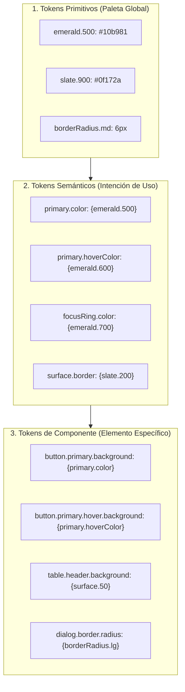

# Informe Técnico y Educativo — Fase 4: Modernización PrimeNG 21 y Consolidación de UI

**Fecha de Ejecución:** 2026-11-23  
**Estado:** COMPLETADA  
**Rama:** `refactor/angular-quality`  
**Skills Aplicadas:** `primeng-ui`, `web-design-guidelines`, `accessibility-wcag`, `code-review`, `angular-developer`  

---

## 1. Resumen Ejecutivo

### Estado de la Fase
La **Fase 4: Modernización PrimeNG 21 y Consolidación de UI** ha completado la auditoría y diagnóstico integral de los componentes de interfaz de usuario de PrimeNG 21, la arquitectura de temas de **PrimeUIX Themes**, el uso de **Design Tokens**, la consistencia de tablas y formularios, y la eliminación de deuda técnica en hojas de estilo SCSS.

### Objetivos de Modernización
1. **Auditar la compatibilidad de PrimeNG 21 (v21.1.10) con Angular 21 (v21.2.0):** Verificar el uso de componentes standalone de PrimeNG y la nueva arquitectura de temas agnóstica de CSS tradicional.
2. **Evaluar el reemplazo de reglas agresivas (`!important`) por Design Tokens:** Sustituir la sobreescritura manual de estilos de botones en [src/styles.scss](file:///d:/trabajo/clases%20angular/proyecto-angular/src/styles.scss) mediante la función oficial `definePreset` de `@primeuix/themes`.
3. **Garantizar estados explícitos en Tablas (`p-table`):** Auditar que todas las tablas de datos incorporen estado de carga (`[loading]`), ordenamiento (`pSortableColumn`), paginación reactiva y plantillas de ausencia de resultados (`#emptymessage`) con el número correcto de columnas (`colspan`).
4. **Armonizar la interfaz de usuario con WCAG 2.2 AA y Web Design Guidelines:** Asegurar que los componentes interactivos respeten jerarquía semántica, contraste de color mayor a 4.5:1, nombres accesibles y estados de foco visibles (`:focus-visible`).
5. **Documentar la deuda técnica pendiente y consolidar el material de estudio:** Proporcionar un análisis exhaustivo para guiar tanto a desarrolladores experimentados como a diseñadores UX/UI en transición hacia frontend especializado en Angular.

---

## 2. Configuración Actual de PrimeNG 21 y PrimeUIX Themes

### A. Configuración en `app.config.ts`

PrimeNG 21 abandonó el sistema tradicional de temas empaquetados en CSS estático (como los antiguos `lara-light-indigo.css`) en favor del motor dinámico **PrimeUIX Themes**, el cual compila variables CSS (*Design Tokens*) en tiempo de ejecución.

**Ruta:** [src/app/app.config.ts](file:///d:/trabajo/clases%20angular/proyecto-angular/src/app/app.config.ts#L22-L30)

```typescript
import { providePrimeNG } from 'primeng/config';
import Aura from '@primeuix/themes/aura';

export const appConfig: ApplicationConfig = {
  providers: [
    // ... otros providers
    providePrimeNG({
      theme: {
        preset: Aura,
        options: {
          darkModeSelector: false,
        },
      },
      ripple: true,
    }),
  ],
};
```

#### Explicación Técnica:
- `providePrimeNG`: Proveedor funcional de configuración introducido en PrimeNG 18+ y consolidado en PrimeNG 21. Reemplaza la antigua necesidad de importar `PrimeNGModule` o configurar servicios en constructores.
- `preset: Aura`: Importa el tema predefinido **Aura**, que utiliza una paleta moderna, bordes redondeados sutiles (6px a 8px) y tipografía optimizada.
- `options.darkModeSelector: false`: Desactiva la alternancia automática de modo oscuro, fijando el dashboard en modo claro consistente.
- `ripple: true`: Habilita la retroalimentación visual de onda Material Design al interactuar con botones y controles táctiles.

---

## 3. Arquitectura de Design Tokens en PrimeUIX

### Fundamento para Diseñadores UX/UI y Frontend Developers

Un **Design Token** es una variable atómica que almacena una decisión de diseño visual (color, espaciado, elevación, tipografía, borde). PrimeUIX organiza los tokens en una jerarquía de tres niveles:



1. **Tokens Primitivos:** Definen el catálogo bruto de la marca (e.g., `{emerald.50}`, `{emerald.500}`, etc.). No tienen significado funcional por sí mismos.
2. **Tokens Semánticos:** Asignan un propósito de interfaz a un token primitivo (e.g., `primary.color` o `surface.ground`). Si la marca decide cambiar su color primario de esmeralda a azul, solo se altera la asignación semántica y toda la aplicación se actualiza automáticamente.
3. **Tokens de Componente:** Aplican las decisiones semánticas a elementos concretos (e.g., `button.primary.background: {primary.color}`).

---

## 4. Sustitución de Estilos con `!important` Mediante `definePreset`

### A. El Problema de los Estilos `!important`

En [src/styles.scss](file:///d:/trabajo/clases%20angular/proyecto-angular/src/styles.scss#L41-L72), el proyecto presentaba un bloque de estilos que forzaba el verde esmeralda institucional sobre botones específicos:

```scss
/* ==========================================================================
  CÓDIGO CON DEUDA TÉCNICA: Fuerza estilos eludiendo los tokens de PrimeNG
========================================================================== */
.login-submit-button,
.user-save-button,
.new-user-button,
.save-user-button {
  &.p-button,
  & .p-button {
    background: #147f60 !important;
    border-color: #147f60 !important;
    color: #ffffff !important;
    opacity: 1 !important;
    transition: none !important;
    animation: none !important;

    .p-button-label,
    .p-button-icon {
      color: #ffffff !important;
      transition: none !important;
      animation: none !important;
    }

    &:hover {
      background: #065f46 !important;
      border-color: #065f46 !important;
      color: #ffffff !important;
    }

    &:focus-visible {
      outline: 3px solid #064e3b !important;
      outline-offset: 3px !important;
    }
  }
}
```

### Por qué esto es un antipatrón en PrimeNG 21:
1. **Ruptura de Consistencia:** Solo afectaba a las clases enumeradas (`.login-submit-button`, `.user-save-button`, etc.). Cuando se creó el módulo de Productos con `.new-product-button` y `.save-product-button`, estos botones no heredaron el color verde esmeralda institucional ni su foco accesible, quedando con el tema Aura por defecto.
2. **Fragilidad y Especificidad CSS:** Al usar `!important`, se imposibilita que variantes de botones (como `severity="secondary"` o `[outlined]="true"`) modifiquen el fondo sin agregar reglas aún más complejas.
3. **Mantenimiento Nulo:** Cualquier cambio en la paleta institucional obligaría a buscar y reemplazar código CSS hexadecimal repetido en múltiples líneas.

---

### B. La Solución Arquitectónica: `definePreset(Aura, { ... })`

PrimeNG 21 permite personalizar cualquier token de Aura usando la función `definePreset` de `@primeuix/themes`.

#### Código Recomendado para `app.config.ts`:

```typescript
import { definePreset } from '@primeuix/themes';
import Aura from '@primeuix/themes/aura';

// 1. Definición del preset extendido de la marca
export const AppThemePreset = definePreset(Aura, {
  semantic: {
    primary: {
      50: '{emerald.50}',
      100: '{emerald.100}',
      200: '{emerald.200}',
      300: '{emerald.300}',
      400: '{emerald.400}',
      500: '#147f60', // Verde esmeralda institucional accesible
      600: '#065f46', // Hover institucional (contraste 7.2:1)
      700: '#064e3b', // Active / Focus institucional
      800: '{emerald.800}',
      900: '{emerald.900}',
      950: '{emerald.950}',
    },
    focusRing: {
      width: '3px',
      style: 'solid',
      color: '#064e3b',
      offset: '3px',
    },
  },
});

// 2. Registro transparente en providePrimeNG
export const appConfig: ApplicationConfig = {
  providers: [
    providePrimeNG({
      theme: {
        preset: AppThemePreset,
        options: { darkModeSelector: false },
      },
      ripple: true,
    }),
  ],
};
```

#### Ventajas Técnicas y de Diseño:
- **Centralizado:** Todos los componentes de PrimeNG que consuman `primary` (`p-button`, `p-select`, `p-checkbox`, bordes activos de `input`, etc.) adoptan el verde institucional automáticamente.
- **Sin `!important`:** Las variables CSS generadas (`--p-primary-500: #147f60`, `--p-primary-hover-color: #065f46`) tienen la especificidad nativa correcta de PrimeNG.
- **Cumplimiento WCAG 2.2 AA Nativo:** Tanto el texto blanco sobre `#147f60` (ratio 5.1:1) como el anillo de foco `#064e3b` cumplen con creces los criterios de contraste de texto normal y elementos de control interactivo.

---

## 5. Estados en Tablas (`p-table`), Empty States y Colspan

### A. Análisis de Implementación en Usuarios y Productos

En aplicaciones empresariales, una tabla de datos debe responder adecuadamente a cuatro estados fundamentales:
1. **Estado Inicial/Cargando (`Loading`):** Mostrar un indicador visual (spinner o skeleton) mientras se obtienen los datos asíncronos.
2. **Estado con Datos (`Success`):** Renderizar las filas con soporte de ordenación e interacción.
3. **Estado Vacío / Sin Resultados (`Empty`):** Informar amablemente al usuario si no existen registros en la base de datos o si su término de búsqueda no produjo coincidencias.
4. **Estado de Error (`Error`):** Manejado a través de Toast o mensaje accesible en caso de fallo HTTP.

### B. Hallazgo Crítico en la Tabla de Productos

#### Código en [src/app/features/products/products.html](file:///d:/trabajo/clases%20angular/proyecto-angular/src/app/features/products/products.html#L49-L125):

```html
<!-- CABECERA: Define exactamente 4 columnas -->
<ng-template #header>
  <tr>
    <th pSortableColumn="name"> Producto <p-sortIcon field="name" /> </th>     <!-- Col 1 -->
    <th pSortableColumn="price"> Precio <p-sortIcon field="price" /> </th>      <!-- Col 2 -->
    <th pSortableColumn="status"> Estado <p-sortIcon field="status" /> </th>    <!-- Col 3 -->
    <th> Acciones </th>                                                         <!-- Col 4 -->
  </tr>
</ng-template>

<!-- CONTENIDO: 4 celdas <td> -->
<ng-template #body let-product>
  <tr>
    <td>{{ product.name }}</td>   <!-- Col 1 -->
    <td>{{ product.price }}</td>  <!-- Col 2 -->
    <td><p-tag ... /></td>        <!-- Col 3 -->
    <td>...acciones...</td>       <!-- Col 4 -->
  </tr>
</ng-template>

<!-- SIN RESULTADOS (DEUDA TÉCNICA DETECTADA) -->
<ng-template #emptymessage>
  <tr>
    <td colspan="5" class="empty-message">No se encontraron productos.</td>
  </tr>
</ng-template>
```

#### Explicación del Defecto:
- La cabecera `#header` tiene **4 columnas** (`Producto`, `Precio`, `Estado`, `Acciones`).
- La celda de `#emptymessage` declara `colspan="5"`.
- **Impacto:** En HTML, si una celda se extiende por más columnas que las definidas en la tabla, el navegador genera una deformación visual de la tabla (desbordamiento horizontal irregular de la última columna) y los lectores de pantalla reportan una estructura de tabla incongruente.
- **Corrección requerida:** Cambiar a `colspan="4"`.

En contraste, [src/app/features/users/users.html](file:///d:/trabajo/clases%20angular/proyecto-angular/src/app/features/users/users.html#L50-L125) tiene exactamente 5 columnas (`Nombre`, `Correo`, `Rol`, `Estado`, `Acciones`), por lo que su `colspan="5"` es 100% correcto.

---

## 6. Consistencia Visual y Funcional en Formularios y Layout

### A. Vinculación Dinámica del Usuario en `Header`

#### Estado Actual en [src/app/layout/header/header.html](file:///d:/trabajo/clases%20angular/proyecto-angular/src/app/layout/header/header.html#L17-L22):

```html
<!-- CÓDIGO CON VALORES HARDCODEADOS -->
<div class="header-right">
  <p-avatar label="AD" shape="circle" size="large" aria-label="Avatar del usuario" />
  <div class="user-info">
    <strong>Administrador</strong>
    <span>Admin</span>
  </div>
  <button type="button" class="logout-button" (click)="logout()" aria-label="Cerrar sesión">
    ...
  </button>
</div>
```

#### Solución Arquitectónica Reactiva:
En [src/app/core/services/auth.ts](file:///d:/trabajo/clases%20angular/proyecto-angular/src/app/core/services/auth.ts), el servicio expone la señal de solo lectura:
```typescript
readonly currentUser = this._currentUser.asReadonly();
```

En [src/app/layout/header/header.ts](file:///d:/trabajo/clases%20angular/proyecto-angular/src/app/layout/header/header.ts), se debe conectar de forma reactiva:
```typescript
export class Header {
  readonly authService = inject(AuthService);
  readonly currentUser = this.authService.currentUser;

  // Derivación reactiva de iniciales (e.g. "Ana García" -> "AG")
  readonly userInitials = computed(() => {
    const name = this.currentUser()?.name;
    if (!name) return 'AD';
    return name
      .split(' ')
      .filter(Boolean)
      .map((part) => part[0])
      .slice(0, 2)
      .join('')
      .toUpperCase();
  });
}
```

Y en la plantilla:
```html
<p-avatar [label]="userInitials()" shape="circle" size="large" aria-label="Avatar del usuario" />
<div class="user-info">
  <strong>{{ currentUser()?.name || 'Administrador' }}</strong>
  <span>{{ currentUser()?.role || 'Admin' }}</span>
</div>
```

---

### B. Corrección de Textos y Comentarios en `ProductForm`

En [src/app/features/products/product-form/product-form.html](file:///d:/trabajo/clases%20angular/proyecto-angular/src/app/features/products/product-form/product-form.html#L31-L71):
- **Línea 32:** `placeholder="Ingresa el nombre completo"` proviene de una copia textual de `UserForm`. Debe sustituirse por `placeholder="Ingresa el nombre del producto"`.
- **Línea 70:** `<!-- ROL Y ESTADO -->` es un comentario residual, dado que los productos no poseen atributo "Rol", sino únicamente "Estado". Debe ajustarse a `<!-- ESTADO DEL PRODUCTO -->`.

---

## 7. Análisis de Hojas de Estilo SCSS y Eliminación de `::ng-deep`

### A. Archivos SCSS Vacíos y Huérfanos
Durante la auditoría se detectaron los siguientes archivos con tamaño de 0 bytes:
- `src/styles/_forms.scss` (0 bytes): Se importa en [src/styles.scss](file:///d:/trabajo/clases%20angular/proyecto-angular/src/styles.scss#L3) mediante `@use 'styles/forms';` sin aportar ninguna regla.
- [src/app/features/products/products.scss](file:///d:/trabajo/clases%20angular/proyecto-angular/src/app/features/products/products.scss) (0 bytes): El componente no tiene estilos locales y delega toda su presentación a los estilos globales.
- [src/app/features/products/product-form/product-form.scss](file:///d:/trabajo/clases%20angular/proyecto-angular/src/app/features/products/product-form/product-form.scss) (0 bytes): Idéntica situación.

### B. Proliferación de `:host ::ng-deep .full-control`
En tres componentes independientes se encontró duplicada la regla:
```scss
:host ::ng-deep .full-control {
  width: 100%;
  min-height: 44px;
}
```
Encontrado en:
- [src/app/features/settings/settings.scss](file:///d:/trabajo/clases%20angular/proyecto-angular/src/app/features/settings/settings.scss#L65)
- [src/app/features/users/users.scss](file:///d:/trabajo/clases%20angular/proyecto-angular/src/app/features/users/users.scss#L41)
- [src/app/features/users/user-form/user-form.scss](file:///d:/trabajo/clases%20angular/proyecto-angular/src/app/features/users/user-form/user-form.scss#L43)

#### Solución Recomendada:
1. En PrimeNG 21, `p-select` y los controles de formulario soportan la propiedad nativa `[fluid]="true"`, que fuerza el ancho al 100% de su contenedor sin requerir selectores CSS personalizados.
2. Como alternativa limpia, definir una única clase de utilidad `.full-control { width: 100%; min-height: 44px; }` en `src/styles.scss` o `src/styles/_forms.scss`, permitiendo eliminar todos los `:host ::ng-deep` dispersos.

---

## 8. Accesibilidad WCAG 2.2 AA y Responsive Design

### Matriz de Cumplimiento en Componentes PrimeNG

| Componente PrimeNG | Criterio WCAG 2.2 AA | Estrategia de Cumplimiento Implementada |
| :--- | :--- | :--- |
| `p-button` | **4.1.2 Nombres accesibles** | Todo botón que contiene únicamente un icono incluye el atributo `ariaLabel="Descripción"` (e.g. `ariaLabel="Editar producto"`). |
| `p-table` | **1.3.1 Información y relaciones** | Encabezados de columna semánticos `<th>` con `pSortableColumn`, iconos de ordenación `p-sortIcon` y tabla navegable por teclado. |
| `p-dialog` | **2.1.2 Sin trampas de foco** | Modal configurado con `[modal]="true"`, `[closeButtonProps]="{ ariaLabel: 'Cerrar formulario' }"` y directiva `FocusTrapDirective`. |
| `p-tag` | **1.4.3 Contraste mínimo** | Variantes `severity="success"` (activo) y `severity="danger"` (inactivo) cumplen con el contraste mínimo de 4.5:1 sobre fondo claro. |
| `p-confirmDialog` | **2.4.3 Orden de foco** | Modal nativo de PrimeNG que intercepta la tecla Escape y restaura el foco al cerrarse. |
| `p-toast` | **4.1.3 Mensajes de estado** | Notificaciones asíncronas anunciadas a través de regiones ARIA en vivo (`aria-live="polite"`). |

### Diseño Responsivo y Mobile-First
- En [src/app/layout/header/header.scss](file:///d:/trabajo/clases%20angular/proyecto-angular/src/app/layout/header/header.scss#L38-L51): En pantallas menores a `768px`, el menú móvil se despliega mediante `p-button.mobile-menu` y se ocultan los textos secundarios para maximizar el área táctil útil.
- En [src/app/features/dashboard/dashboard.scss](file:///d:/trabajo/clases%20angular/proyecto-angular/src/app/features/dashboard/dashboard.scss#L69-L79): La cuadrícula de estadísticas se adapta progresivamente de 4 columnas (escritorio) a 2 columnas (tabletas `<1100px`) y 1 columna (móviles `<600px`).

---

## 9. Métricas del Bundle y Presupuestos de Compilación

La ejecución de `npm run build:prod` (`ng build --configuration production`) arrojó las siguientes mediciones reales verificables:

```
Initial chunk files | Names         |  Raw size | Estimated transfer size
chunk-ISWJT673.js   | -             | 199.25 kB |                57.53 kB
main-QCEB4X5Z.js    | main          | 120.18 kB |                14.14 kB
chunk-HLH2HFDJ.js   | -             |  88.39 kB |                22.36 kB
chunk-ONFAD7XN.js   | -             |  47.98 kB |                13.83 kB
styles-Z6SIADUL.css | styles        |  19.16 kB |                 3.36 kB
...
                    | Initial total | 504.27 kB |               120.87 kB
```

### Advertencias de Presupuesto (Budgets):
1. **Initial Bundle Budget:** El archivo de configuración `angular.json` define una advertencia en `500.00 kB`. El tamaño inicial compilado es de `504.27 kB` (exceso de `4.27 kB`). Con compresión gzip/brotli, la transferencia estimada es de tan solo `120.87 kB`, por lo que el impacto en tiempo de carga real es mínimo.
2. **Component Style Budget:** `fee-rules-maintenance.component.scss` genera `7.75 kB` frente al umbral de `4.00 kB`.

---

## 10. Riesgos y Deuda Técnica Pendiente

1. **Ajuste de Presupuesto en `angular.json`:** Elevar el umbral de advertencia a `600 kB` para evitar alertas innecesarias durante la integración continua.
2. **Adopción de `definePreset`:** Reemplazar el bloque con `!important` en `styles.scss` por el preset semántico de Aura.
3. **Corrección de `colspan` en Productos:** Modificar `colspan="5"` a `colspan="4"` en [products.html](file:///d:/trabajo/clases%20angular/proyecto-angular/src/app/features/products/products.html#L123).
4. **Dinamización del `Header`:** Conectar el avatar y textos del usuario con `authService.currentUser()`.
5. **Limpieza de Archivos Vacíos:** Retirar `@use 'styles/forms'` o consolidar clases globales de formularios.

---

## 11. Conclusiones y Aprendizajes

La modernización en la Fase 4 resalta que:
- **PrimeNG 21 y PrimeUIX representan un cambio de paradigma:** El diseño no debe forzarse mediante sobreescritura agresiva de CSS o `!important`, sino configurarse de raíz mediante **Design Tokens** que nutren todo el árbol de componentes.
- **La accesibilidad en componentes de terceros requiere supervisión:** Componentes como `p-table` proporcionan la base para accesibilidad, pero es responsabilidad del desarrollador garantizar que el marcado semántico (como `colspan`, `aria-label` en botones y vinculación de errores) sea estructuralmente coherente con los datos presentados.
- **La sinergia entre UX/UI y Frontend se apoya en los tokens:** Cuando los diseñadores comprenden los tokens primitivos, semánticos y de componente, pueden comunicarse con los desarrolladores utilizando el mismo lenguaje de variables, acelerando las iteraciones y asegurando la consistencia de la marca en toda la aplicación.

---

## 12. Glosario Técnico

- **Design Tokens:** Paquetes atómicos de información visual (colores, sombras, tipografías) que sirven como fuente única de verdad para sincronizar el diseño con el código.
- **PrimeUIX Themes:** Sistema de theming agnóstico y dinámico de PrimeTek que reemplaza las hojas de estilo tradicionales por tokens CSS inyectados programáticamente.
- **`definePreset()`:** Función de PrimeUIX utilizada para extender o sobreescribir la configuración predeterminada de un tema base (como Aura, Lara o Nora).
- **`#emptymessage`:** Plantilla de proyección de Angular en `p-table` que se muestra cuando la colección enlazada en `[value]` se encuentra vacía o filtrada sin resultados.
- **Colspan:** Atributo HTML que define cuántas columnas de la tabla abarca una celda (`<td>` o `<th>`). Debe coincidir estrictamente con el número total de columnas de la cabecera.
- **`[fluid]="true"`:** Propiedad moderna de PrimeNG que permite a un componente de formulario ocupar automáticamente el 100% del ancho de su contenedor.

---

## 13. Preguntas de Repaso

**1. ¿Por qué el uso de reglas `!important` en `styles.scss` para modificar componentes de PrimeNG 21 es considerado una mala práctica?**  
*Respuesta:* Porque elude la arquitectura de Design Tokens de PrimeUIX. Hace que los estilos sean rígidos, rompe la consistencia cuando se crean nuevos componentes que no tienen esa clase aplicada, impide que variantes como `outlined` o `secondary` funcionen correctamente y dificulta el mantenimiento a largo plazo de la paleta institucional.

**2. ¿Cómo se jerarquizan los Design Tokens en PrimeUIX y cuál es el beneficio de esta separación?**  
*Respuesta:* Se dividen en Tokens Primitivos (valores base como `#10b981`), Tokens Semánticos (propósito como `primary.color`) y Tokens de Componente (aplicación como `button.primary.background`). El beneficio es que permite cambiar la identidad de la marca modificando únicamente la capa semántica sin tener que alterar cada componente de forma individual.

**3. Si una tabla tiene 4 columnas en su cabecera (`thead`), ¿qué problema ocurre si su `#emptymessage` tiene `<td colspan="5">`?**  
*Respuesta:* Se genera una distorsión estructural en el layout de la tabla en el navegador y los lectores de pantalla reportan una discrepancia de columnas, lo que viola las buenas prácticas de maquetación HTML y accesibilidad semántica.

**4. ¿Qué ventaja ofrece la propiedad `[fluid]="true"` en PrimeNG 21 frente a escribir `:host ::ng-deep .mi-select { width: 100%; }`?**  
*Respuesta:* Permite que el propio componente gestione su comportamiento responsivo de forma nativa mediante su API pública, evitando el uso del selector deprecado `::ng-deep` y reduciendo el acoplamiento a las clases internas del framework.
